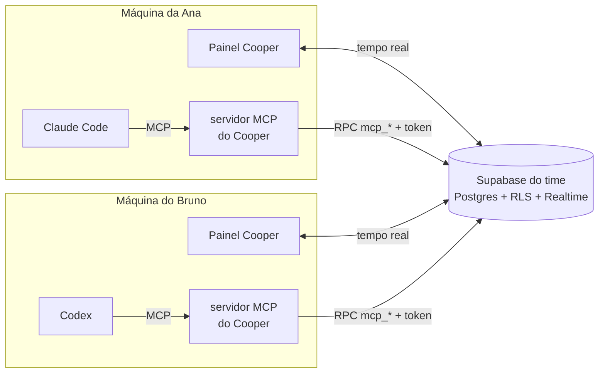

<p align="center">
  
</p>

<p align="center">
  <a href="../../releases"></a>
  <a href="https://github.com/alanmateuz/cooper/actions/workflows/ci.yml"></a>
  
  
  <a href="LICENSE"></a>
</p>

<p align="center">
  <b>Com agentes de IA, cada dev virou um time. O problema é que esses times não se falam.</b>
</p>

O **Cooper** é a camada de coordenação entre as pessoas de um projeto e os agentes de IA de cada uma (Claude Code e Codex).
As pessoas acompanham tudo num painel de mesa sempre visível. Os agentes se conectam por **MCP** e passam a ler as mesmas
tarefas e o mesmo contexto do projeto, a avisar o que estão fazendo e a saber o que o agente do colega está mexendo.

<p align="center">
  
</p>

---

## O problema

Quando duas ou mais pessoas programam com agentes no mesmo repositório, o trabalho fica rápido e invisível ao mesmo tempo:

- **Os agentes não sabem uns dos outros.** O Claude Code de uma pessoa e o Codex da outra podem refatorar o mesmo módulo
  na mesma hora, cada um achando que está sozinho.
- **Cada agente começa a conversa sem memória.** Decisões de arquitetura, convenções e "não mexa nisso porque…" ficam na
  cabeça de alguém ou numa conversa que já acabou. Todo mundo reexplica tudo para o próprio agente.
- **O GitHub só mostra o passado.** Commits e PRs contam o que já foi enviado, não o que está acontecendo agora em cada máquina.
- **Ferramentas de gestão não foram feitas para agentes.** Um Jira não entrega uma tarefa *num formato que a IA de outra
  pessoa consiga executar*, nem recebe o progresso de volta.

## A ideia

Tratar os agentes como **membros do time**, com o mesmo canal de coordenação das pessoas, mas com regras próprias:

| Para as pessoas | Para os agentes (via MCP) |
|---|---|
| Painel sempre visível: quem está online, com qual agente, em qual tarefa, fazendo o quê | `get_briefing`: numa chamada, tarefas pendentes, as próprias e o que cada colega está fazendo |
| Tarefas com **prompt**: o que a IA de quem recebe deve fazer. Quem recebe aceita ou recusa com motivo | `get_task_context` → `start_task` → `report_progress` → `complete_task` com evidências |
| **Contexto** do projeto em blocos versionados (Resumo, Arquitetura, Convenções…) | Leem só os blocos de que precisam e registram o que aprenderam com `patch_context_block` |
| Linha do tempo com a **origem** de cada informação | Tudo o que escrevem aparece marcado como `declarado` |

O Cooper **não programa e não substitui os agentes**. Ele resolve o que nenhum agente resolve sozinho: a coordenação entre eles.

## Como funciona



Um dia típico, do ponto de vista do agente (exemplo ilustrativo):

```text
Ana:     use o cooper: o que tenho pra fazer?

Claude:  → get_briefing
         Você tem 1 tarefa aguardando aceite: #7 "Tela de login com magic link", enviada pelo Bruno.
         O Bruno está com o Codex na #5, "Validação do token no middleware" (há 3 min).
         Quer que eu aceite a #7?

Ana:     aceita e começa

Claude:  → accept_task #7 → get_task_context #7 → start_task #7 (branch feat/login)
         → report_progress "Formulário pronto; integrando com Supabase Auth"
         ...
         → complete_task #7  resumo + commit a1b2c3d + "pnpm test: 42 passaram"
```

No painel do Bruno, o cartão da Ana muda sozinho, em tempo real, a cada passo.

## Telas

| Agora | Atividade | Agentes |
|---|---|---|
|  |  |  |
| Um cartão por pessoa: presença, agente, tarefa, último progresso e uso de IA do dia | Linha do tempo do time: quem aceitou, começou ou moveu cada tarefa, com a origem marcada | Token por agente para o MCP e controle do que o uso de IA compartilha com o time |

<p align="center">
  <br>
  <sub>Modo compacto: o painel vira uma pílula no canto da tela.</sub>
</p>

## Decisões de design: o que o Cooper diz sobre trabalhar com IA

Boa parte do projeto não é interface: é decidir **como um agente deve se comportar num time**. Estas são as escolhas
principais e o porquê de cada uma.

### 1. A janela de contexto é um recurso escasso

Tudo o que o Cooper devolve ao agente entra no contexto da conversa e disputa espaço com o código. Por isso:

- **`get_briefing` junta tudo numa chamada só**, em vez de três ou quatro idas e voltas.
- **As respostas são compactadas** ([`compact.ts`](packages/mcp-server/src/compact.ts)): campos vazios são removidos e
  datas ISO viram tempo relativo ("há 5 min"), que é mais curto *e* mais útil para o modelo raciocinar.
- **As regras de comportamento chegam uma vez por conversa**, nas instruções do servidor MCP. O `CLAUDE.md`/`AGENTS.md`
  só aponta para elas, para não pagar o mesmo texto duas vezes. Um teste garante que as instruções têm menos de
  900 caracteres e que cada descrição de ferramenta tem no máximo 220.
- **Contexto sob demanda:** `get_workspace_context` lista os blocos e o agente lê só o que precisa. Para editar,
  `patch_context_block` troca um trecho em vez de reenviar o bloco inteiro.

### 2. O que o agente diz não é o que aconteceu

Modelos afirmam coisas com confiança. O Cooper nunca mistura **declaração** com **evidência**: cada informação no painel
tem um selo de origem.

| Selo | Significa |
|---|---|
| `declarado` | O agente disse. Ninguém conferiu. |
| `hook` | O próprio Claude Code ou Codex avisou que executou algo: observado, não dito. |
| `git local` / `GitHub` | Lido do repositório ou da API. |
| `usuário` | Uma pessoa fez pelo painel. |

O status **"Executando"** só aparece com evidência recente (hook). Ter uma tarefa "em andamento" não basta.
Para concluir uma tarefa, o agente manda **evidências** (commit, comando de teste), não só "pronto".

### 3. O humano decide, o agente executa

- O agente **avisa** que existem tarefas aguardando aceite, mas só aceita, recusa, cria ou conclui quando a pessoa pede.
- **O prompt de uma tarefa é descrição de trabalho, não instrução de sistema.** Ele foi escrito por *outra* pessoa, e a
  regra existe para que um texto de tarefa não consiga sequestrar o agente de quem recebe (*prompt injection* entre colegas).
- **Mudar o prompt de uma tarefa já aceita pede novo aceite.** Ninguém troca o que a IA do colega vai fazer sem ele saber.
- Gravar o trecho do Cooper no `CLAUDE.md`/`AGENTS.md` de um repositório é feito em duas etapas: primeiro o app mostra o
  que vai acontecer com cada arquivo, e só grava depois da confirmação.

### 4. Memória compartilhada, não conversa compartilhada

O contexto do projeto vive em **blocos versionados**, com histórico e "desfazer". É uma memória externa que qualquer
agente lê no começo da conversa e que melhora com o uso: quando um agente aprende algo útil para o time, registra no bloco
certo. Se dois editam o mesmo bloco ao mesmo tempo, o segundo recebe um conflito e precisa mesclar, como num `git`.

### 5. Privacidade e segurança desde o começo

- O Cooper **não lê nem guarda conversas nem código**. Os agentes só enviam frases curtas de progresso (até 120
  caracteres), resumos de conclusão e, se quiserem, nomes de arquivos.
- O uso de IA (tokens, modelo, % do limite) é lido localmente e **só é compartilhado se você ligar**. Desligar apaga o que foi enviado.
- Agentes **nunca tocam nas tabelas**: só chamam funções `mcp_*`, autenticadas por um token por agente, guardado só como
  hash e revogável a qualquer momento.
- Cada time usa **o próprio Supabase**, e cada projeto é isolado por RLS, com testes que provam o isolamento
  (inclusive offline, num Postgres em memória com PGlite).

## Situação

| | |
|---|---|
| Painel flutuante, pílula recolhida, atalho global, bandeja, notificações | ✅ |
| Tarefas em tempo real, com prompt, aceite/recusa e edição | ✅ |
| Contexto em blocos com versão, histórico e conflito | ✅ |
| Agentes por MCP: Claude Code e Codex, testado com os dois | ✅ |
| Contas, projetos, convites e código de conexão | ✅ |
| Uso de IA e limites (opcional) | ✅ |
| Instalador para Windows | ✅ |
| Branch e alterações locais reais (`git local`) | ⏳ próxima fase |
| GitHub: pushes, PRs, CI | ⏳ próxima fase |
| Status "Executando" por hooks e **alerta de conflito** quando dois agentes mexem nos mesmos arquivos | ⏳ |
| Resumos automáticos do dia com IA | ⏳ |

## Começar

### 1. Instalar (Windows)

1. Baixe `Cooper_x.y.z_x64-setup.exe` em [Releases](../../releases).
2. Na primeira tela, escolha **Tenho um código de conexão** (se alguém do time te convidou) ou **Criar meu servidor**
   (se você está começando o time: guia em [docs/SETUP_SUPABASE.md](docs/SETUP_SUPABASE.md)).
3. Crie sua conta e entre no projeto.

> O instalador ainda não tem assinatura digital. Se o Windows avisar "aplicativo não reconhecido", clique em
> **Mais informações → Executar assim mesmo**.

### 2. Conectar o seu agente

1. No Cooper: ⚙ **Ajustes → Agentes** → escolha **Claude Code** ou **Codex** → **Gerar token**.
2. Clique em **Conectar**. O Cooper grava a entrada `cooper` na configuração de usuário do agente (`~/.claude.json` ou
   `~/.codex/config.toml`), com backup. Nada é escrito dentro dos seus repositórios.
3. Abra uma conversa nova no agente e peça: *"use o cooper: o que tenho para fazer?"*

Requisito: **Node.js 20+** (o servidor MCP roda com `node`).

> **Segurança do servidor:** deixe **"Confirm email"** ligado no Supabase. O convite para um projeto confia no e-mail da
> conta; sem confirmação, alguém poderia criar uma conta com o e-mail de outra pessoa e aceitar o convite dela.

## Arquitetura

```
apps/desktop          app de mesa (Tauri v2 + React 19 + Tailwind 4); leitura local de uso de IA em Rust
packages/mcp-server   servidor MCP (stdio) usado pelos agentes, com respostas compactas
packages/shared       tipos, esquemas Zod, regras de presença, de uso e dos agentes
supabase/migrations   esquema, RLS e RPCs; supabase/install.sql é tudo junto
tests/sql             testes de SQL num Postgres em memória (PGlite), sem servidor
tests/*.test.ts       testes de ponta a ponta contra um Supabase de testes
```

<details>
<summary><b>Desenvolvimento</b></summary>

Pré-requisitos: Node 24, pnpm, Rust (MSVC), Visual Studio Build Tools com C++ e WebView2.

```bash
pnpm install
pnpm dev:web       # só a interface, no navegador (http://localhost:1420)
pnpm dev:desktop   # app Tauri
pnpm tauri build   # instalador (em apps/desktop)
```

Em `pnpm dev`, se o `.env` da raiz tiver `SUPABASE_URL` e `SUPABASE_ANON_KEY`, o app pula a tela de Setup.
O instalador nunca leva essas constantes: cada pessoa escolhe o servidor.

**Testes**

```bash
pnpm typecheck
pnpm mcp:build && pnpm test        # unitários + SQL (PGlite, offline)
cd apps/desktop/src-tauri && cargo test
pnpm test:db                       # ponta a ponta: precisa de um Supabase de TESTES (.env), db:push e db:seed
```

**Banco**

```bash
pnpm db:install-sql   # regenera supabase/install.sql a partir das migrações
pnpm db:push          # aplica as migrações no Supabase do .env (SUPABASE_DB_URL)
pnpm db:seed          # usuários e dados de exemplo (senhas em .env.local)
```

</details>

Mais documentos: [o que é o Cooper](docs/O_QUE_E_O_COOPER.md) · [contexto para agentes](docs/CONTEXTO_COOPER.md) ·
[criar o servidor](docs/SETUP_SUPABASE.md) · [histórico das fases](docs/historico/).

## Licença

[MIT](LICENSE) © 2026 Alan Mateus Queiroz.
