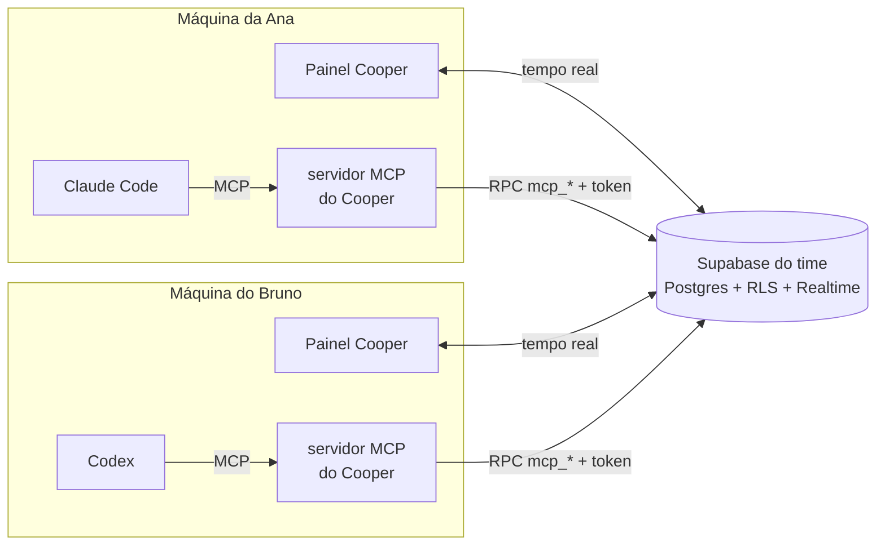

<p align="center">
  
</p>

<p align="center">
  <a href="../../releases"></a>
  <a href="https://github.com/alanmateuz/cooper/actions/workflows/ci.yml"></a>
  
  
  <a href="LICENSE"></a>
</p>

O Cooper coordena o trabalho de times que programam com agentes de IA (Claude Code e Codex). As pessoas acompanham o
time num painel de mesa sempre visível, e os agentes de cada uma se conectam ao Cooper por MCP: leem as mesmas tarefas e o
mesmo contexto do projeto, informam o que estão fazendo e consultam o que os agentes dos colegas estão fazendo.

<p align="center">
  
</p>

---

## Motivação

O projeto começou do uso em dupla, com cada pessoa trabalhando com o próprio agente no mesmo repositório. Alguns
problemas apareceram com frequência:

- Os agentes não têm informação uns sobre os outros. O Claude Code de uma pessoa e o Codex da outra podem alterar o mesmo
  módulo ao mesmo tempo.
- Cada conversa começa sem memória do projeto. Decisões de arquitetura e convenções precisam ser explicadas de novo a cada sessão.
- O GitHub mostra apenas o que já foi enviado, e não o que está em andamento em cada máquina.
- Ferramentas de gestão de tarefas não entregam o trabalho num formato que o agente de outra pessoa consiga executar, nem
  recebem o progresso de volta.

## O que o Cooper faz

| Para as pessoas | Para os agentes (via MCP) |
|---|---|
| Painel com quem está online, com qual agente, em qual tarefa e o último progresso | `get_briefing` traz, numa chamada, as tarefas pendentes, as próprias e o que cada colega está fazendo |
| Tarefas com prompt, ou seja, o que a IA de quem recebe deve fazer. Quem recebe aceita ou recusa com motivo | `get_task_context`, `start_task`, `report_progress` e `complete_task` com evidências |
| Contexto do projeto em blocos versionados (Resumo, Arquitetura, Convenções…) | Leitura apenas dos blocos necessários e edição de trechos com `patch_context_block` |
| Linha do tempo com a origem de cada informação | Tudo o que o agente registra aparece como `declarado` |

O Cooper não programa e não substitui os agentes. Ele cuida da coordenação entre eles e entre as pessoas.

## Vantagens para quem trabalha com IA

- **Menos conflito entre agentes.** Antes de editar arquivos, o agente consulta o que o time está fazendo e avisa se houver sobreposição.
- **Menos contexto repetido.** O agente lê os blocos de contexto do time no início da conversa e registra o que aprendeu,
  em vez de depender de explicações refeitas a cada sessão.
- **Delegação entre pessoas.** Uma tarefa pode ser enviada já com o prompt pronto para o agente de outra pessoa executar.
- **Acompanhamento automático.** O progresso é informado pelo próprio agente e aparece no painel em tempo real, sem
  atualização manual de quadros.
- **Baixo custo de tokens.** O briefing vem numa única chamada e as respostas são compactadas.
- **Visibilidade do uso.** Opcionalmente, o painel mostra tokens do dia e o percentual de limite do Claude Code e do Codex de cada pessoa.

## Como funciona



Exemplo de uso com o agente:

```text
Ana:     use o cooper: o que tenho pra fazer?

Claude:  → get_briefing
         Você tem 1 tarefa aguardando aceite: #7 "Tela de login com magic link", enviada pelo Bruno.
         O Bruno está com o Codex na #5, "Validação do token no middleware" (há 3 min).
         Quer que eu aceite a #7?

Ana:     aceita e começa

Claude:  → accept_task #7 → get_task_context #7 → start_task #7 (branch feat/login)
         → report_progress "Formulário pronto; integrando com Supabase Auth"
         ...
         → complete_task #7  resumo + commit a1b2c3d + "pnpm test: 42 passaram"
```

O painel do Bruno é atualizado em tempo real a cada um desses passos.

## Telas

| Agora | Atividade | Agentes |
|---|---|---|
|  |  |  |
| Um cartão por pessoa: presença, agente, tarefa, último progresso e uso de IA do dia | Linha do tempo do time, com quem aceitou, iniciou ou moveu cada tarefa | Token por agente para o MCP e controle do que o uso de IA compartilha com o time |

<p align="center">
  <br>
  <sub>Modo compacto.</sub>
</p>

## Decisões de design

### Uso eficiente do contexto

Tudo o que o Cooper devolve ao agente ocupa espaço na janela de contexto da conversa. Por isso:

- `get_briefing` reúne numa chamada o que antes exigiria três ou quatro.
- As respostas são compactadas ([`compact.ts`](packages/mcp-server/src/compact.ts)): campos vazios são removidos e datas
  ISO são convertidas em tempo relativo ("há 5 min").
- As regras de comportamento são enviadas uma vez por conversa, nas instruções do servidor MCP. O `CLAUDE.md`/`AGENTS.md`
  apenas aponta para elas. Testes limitam as instruções a 900 caracteres e cada descrição de ferramenta a 220.
- O agente lista os blocos de contexto e lê apenas os que precisa. Para editar, troca um trecho em vez de reenviar o bloco inteiro.

### Origem das informações

O painel distingue o que foi declarado pelo agente do que foi observado:

| Selo | Significado |
|---|---|
| `declarado` | Informado pelo agente, sem verificação. |
| `hook` | Evento emitido pelo próprio Claude Code ou Codex ao executar algo. |
| `git local` / `GitHub` | Lido do repositório ou da API do GitHub. |
| `usuário` | Ação feita por uma pessoa no painel. |

O status "Executando" só aparece com evento recente de hook. Ao concluir uma tarefa, o agente envia evidências, como o
commit e o comando de teste executado.

### Controle humano

- O agente informa as tarefas aguardando aceite, mas só aceita, recusa, cria ou conclui tarefas quando a pessoa pede.
- O prompt de uma tarefa é tratado como descrição de trabalho e não como instrução de sistema, já que foi escrito por
  outra pessoa. Isso reduz o risco de *prompt injection* entre membros do time.
- Alterar o prompt de uma tarefa já aceita exige um novo aceite.
- A gravação do trecho do Cooper no `CLAUDE.md`/`AGENTS.md` de um repositório mostra antes o que será alterado em cada
  arquivo e só acontece após confirmação.

### Contexto compartilhado

O contexto do projeto é guardado em blocos versionados, com histórico e opção de desfazer. Qualquer agente do time pode
lê-los no início da conversa e atualizá-los quando aprende algo relevante. Edições simultâneas no mesmo bloco geram
conflito, que precisa ser resolvido antes de salvar.

### Privacidade e segurança

- O Cooper não lê nem armazena conversas ou código. Os agentes enviam apenas frases curtas de progresso (até 120
  caracteres), resumos de conclusão e, opcionalmente, nomes de arquivos.
- O uso de IA (tokens, modelo e percentual de limite) é lido localmente e só é compartilhado se a pessoa ativar. Ao
  desativar, os dados enviados são apagados.
- Os agentes não acessam as tabelas diretamente: usam apenas funções `mcp_*`, autenticadas por um token por agente,
  armazenado como hash e revogável.
- Cada time usa o próprio Supabase, e cada projeto é isolado por RLS, com testes automatizados (incluindo testes offline
  com PGlite).

## Situação

| | |
|---|---|
| Painel flutuante, modo compacto, atalho global, bandeja e notificações | ✅ |
| Tarefas em tempo real, com prompt, aceite/recusa e edição | ✅ |
| Contexto em blocos com versão, histórico e conflito | ✅ |
| Agentes por MCP, testado com Claude Code e Codex | ✅ |
| Contas, projetos, convites e código de conexão | ✅ |
| Uso de IA e limites (opcional) | ✅ |
| Instalador para Windows | ✅ |
| Branch e alterações locais (`git local`) | ⏳ |
| Integração com GitHub (pushes, PRs, CI) | ⏳ |
| Status "Executando" por hooks e alerta quando dois agentes alteram os mesmos arquivos | ⏳ |
| Resumos diários gerados por IA | ⏳ |

## Começar

### 1. Instalar (Windows)

1. Baixe `Cooper_x.y.z_x64-setup.exe` em [Releases](../../releases).
2. Na primeira tela, escolha **Tenho um código de conexão**, se alguém do time enviou um convite, ou **Criar meu servidor**,
   se você está criando o time (guia em [docs/SETUP_SUPABASE.md](docs/SETUP_SUPABASE.md)).
3. Crie sua conta e entre no projeto.

> O instalador ainda não tem assinatura digital. Se o Windows exibir "aplicativo não reconhecido", clique em
> **Mais informações → Executar assim mesmo**.

### 2. Conectar o agente

1. No Cooper, abra **Ajustes → Agentes**, escolha **Claude Code** ou **Codex** e clique em **Gerar token**.
2. Clique em **Conectar**. O Cooper adiciona a entrada `cooper` à configuração de usuário do agente (`~/.claude.json` ou
   `~/.codex/config.toml`), com backup. Nenhum arquivo dos seus repositórios é alterado.
3. Abra uma conversa nova no agente e peça: *"use o cooper: o que tenho para fazer?"*

Requisito: Node.js 20 ou superior (o servidor MCP roda com `node`).

> No Supabase, mantenha **"Confirm email"** ativado. O convite para um projeto é validado pelo e-mail da conta; sem
> confirmação, alguém poderia criar uma conta com o e-mail de outra pessoa e aceitar o convite.

## Arquitetura

```
apps/desktop          app de mesa (Tauri v2 + React 19 + Tailwind 4); leitura local de uso de IA em Rust
packages/mcp-server   servidor MCP (stdio) usado pelos agentes
packages/shared       tipos, esquemas Zod e regras de presença, uso e agentes
supabase/migrations   esquema, RLS e RPCs; supabase/install.sql reúne tudo
tests/sql             testes de SQL num Postgres em memória (PGlite)
tests/*.test.ts       testes de ponta a ponta contra um Supabase de testes
```

<details>
<summary><b>Desenvolvimento</b></summary>

Pré-requisitos: Node 24, pnpm, Rust (MSVC), Visual Studio Build Tools com C++ e WebView2.

```bash
pnpm install
pnpm dev:web       # só a interface, no navegador (http://localhost:1420)
pnpm dev:desktop   # app Tauri
pnpm tauri build   # instalador (em apps/desktop)
```

Em `pnpm dev`, se o `.env` da raiz tiver `SUPABASE_URL` e `SUPABASE_ANON_KEY`, o app pula a tela de Setup.
O instalador não inclui essas constantes: cada pessoa escolhe o servidor.

**Testes**

```bash
pnpm typecheck
pnpm mcp:build && pnpm test        # unitários + SQL (PGlite, offline)
cd apps/desktop/src-tauri && cargo test
pnpm test:db                       # ponta a ponta: requer um Supabase de testes (.env), db:push e db:seed
```

**Banco**

```bash
pnpm db:install-sql   # regenera supabase/install.sql a partir das migrações
pnpm db:push          # aplica as migrações no Supabase do .env (SUPABASE_DB_URL)
pnpm db:seed          # usuários e dados de exemplo (senhas em .env.local)
```

</details>

Mais documentos: [o que é o Cooper](docs/O_QUE_E_O_COOPER.md) · [contexto para agentes](docs/CONTEXTO_COOPER.md) ·
[criar o servidor](docs/SETUP_SUPABASE.md) · [histórico das fases](docs/historico/).

## Licença

[MIT](LICENSE) © 2026 Alan Mateus Queiroz.
