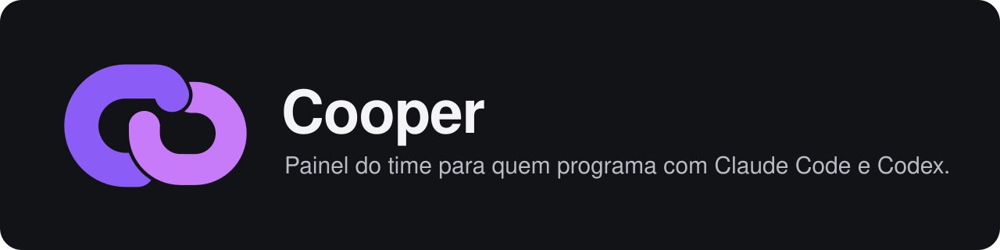
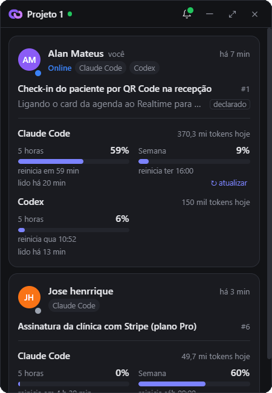
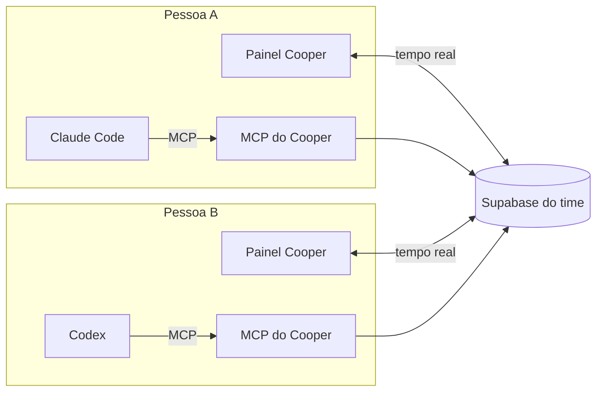
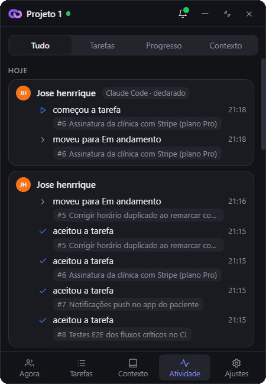
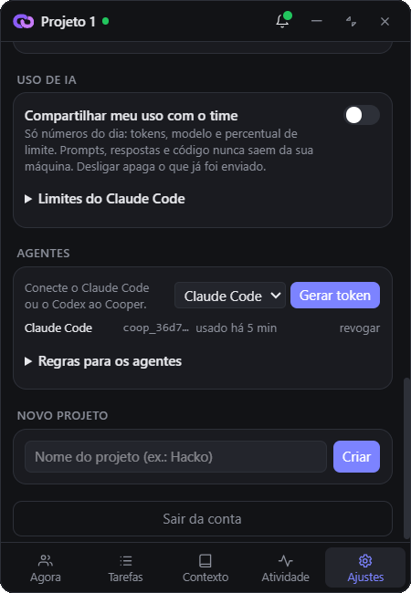

<p align="center">
  
</p>

<p align="center">
  <a href="../../releases"></a>
  <a href="https://github.com/alanmateuz/cooper/actions/workflows/ci.yml"></a>
  <a href="LICENSE"></a>
</p>

O Cooper é um app de mesa para times que programam com agentes de IA (Claude Code e Codex). Ele mostra o que cada pessoa
está fazendo e conecta os agentes de todo mundo às mesmas tarefas e ao mesmo contexto do projeto, usando MCP.

<p align="center">
  
</p>

## Por que eu fiz

Eu programo em dupla, cada um com o seu agente. O problema é que o meu Claude Code não sabe o que o Codex do meu colega
está fazendo. Os dois já mexeram no mesmo arquivo ao mesmo tempo, e a cada conversa nova eu tinha que explicar de novo
as decisões do projeto. O GitHub não ajuda nisso, porque só mostra o que já foi commitado.

O Cooper resolve isso com duas coisas: um painel pequeno que fica aberto no canto da tela, e um servidor MCP que dá ao
agente de cada pessoa acesso às tarefas, ao contexto e ao que o resto do time está fazendo.

## O que muda para quem usa IA

- **O agente sabe o que o colega está fazendo.** Antes de editar, ele vê em qual tarefa cada pessoa está e avisa se houver
  risco de mexer na mesma parte do código.
- **Menos explicação repetida.** Arquitetura, convenções e decisões ficam em blocos de contexto compartilhados. O agente lê
  o que precisa no começo da conversa e atualiza quando aprende algo novo.
- **Tarefas com prompt.** Dá para mandar uma tarefa para outra pessoa já escrita para a IA dela executar. A pessoa aceita
  ou recusa antes de qualquer coisa acontecer.
- **Progresso sem esforço.** O agente avisa quando começa, o que está fazendo e quando termina (com commit e resultado dos
  testes). O painel atualiza sozinho e ninguém precisa mexer em quadro de tarefas.
- **Gasta pouco contexto.** Uma única chamada traz tudo o que o agente precisa para começar, e as respostas vêm enxutas.
- **Uso de IA do time.** Se cada um quiser, o painel mostra tokens do dia e quanto falta do limite do Claude Code e do Codex.

## Como funciona



Na prática, a conversa com o agente fica assim:

```text
Você:    use o cooper: o que tenho pra fazer?
Claude:  Tem 1 tarefa esperando seu aceite: #7 "Tela de login", enviada pelo Bruno.
         O Bruno está com o Codex na #5, "Validação do token no middleware".
Você:    aceita e começa
Claude:  (aceita, lê o prompt da #7, marca como em andamento e vai avisando o progresso)
```

## Telas

| Agora | Atividade | Ajustes |
|---|---|---|
|  |  |  |
| Cada pessoa, o agente, a tarefa atual e o uso de IA | O que aconteceu no dia, tarefa por tarefa | Conectar o agente e escolher o que compartilhar |

Recolhido, o painel vira uma barra pequena:


## Algumas decisões

- **O que o agente diz aparece marcado como `declarado`.** Fica separado do que foi observado de fato (hooks, git) e do que
  uma pessoa fez, para ninguém confundir o que a IA afirmou com o que aconteceu.
- **A pessoa decide, o agente executa.** O agente só aceita, cria ou conclui tarefas quando você pede. O prompt de uma
  tarefa vale como descrição de trabalho, não como instrução de sistema, e mudar o prompt de uma tarefa aceita pede novo aceite.
- **Contexto é caro.** As regras chegam uma vez por conversa, as respostas tiram campos vazios e trocam datas por "há 5 min",
  e o agente edita só o trecho do contexto que mudou. Há testes que limitam o tamanho das instruções.
- **Privacidade.** O Cooper não lê conversas nem código. Os agentes mandam só frases curtas de progresso. Cada time usa o
  próprio Supabase, cada projeto é isolado por RLS, e os tokens dos agentes são guardados como hash e podem ser revogados.

## Situação

Funcionando: painel, tarefas com prompt e aceite, contexto compartilhado, convites, agentes por MCP (testado com Claude
Code e Codex), uso de IA e instalador para Windows.

Próximos passos: ler branch e alterações locais do git, integrar com o GitHub e avisar quando dois agentes estiverem
mexendo nos mesmos arquivos.

## Instalar

1. Baixe o instalador em [Releases](../../releases) (Windows). Se aparecer o aviso de app não reconhecido, clique em
   **Mais informações → Executar assim mesmo**.
2. Na primeira tela, cole o código de conexão que o time te mandou, ou crie o servidor do time seguindo
   [docs/SETUP_SUPABASE.md](docs/SETUP_SUPABASE.md).
3. Em **Ajustes → Agentes**, gere um token e clique em **Conectar**. Precisa do Node.js 20 ou mais novo.
4. Abra uma conversa nova no Claude Code ou no Codex e peça: *"use o cooper: o que tenho para fazer?"*

<details>
<summary><b>Desenvolvimento</b></summary>

Stack: Tauri 2, React 19 e Tailwind 4 no app; servidor MCP em TypeScript; Supabase (Postgres, RLS e Realtime) no banco.

```
apps/desktop          app de mesa
packages/mcp-server   servidor MCP usado pelos agentes
packages/shared       tipos e regras compartilhadas
supabase/migrations   esquema, RLS e funções (supabase/install.sql junta tudo)
tests/                testes de SQL offline (PGlite) e de ponta a ponta
```

Pré-requisitos: Node 24, pnpm, Rust (MSVC), Visual Studio Build Tools com C++ e WebView2.

```bash
pnpm install
pnpm dev:web       # só a interface, em http://localhost:1420
pnpm dev:desktop   # app Tauri
pnpm typecheck
pnpm mcp:build && pnpm test
```

No Supabase, deixe "Confirm email" ligado: o convite confia no e-mail da conta.
Mais detalhes em [docs/O_QUE_E_O_COOPER.md](docs/O_QUE_E_O_COOPER.md) e [docs/SETUP_SUPABASE.md](docs/SETUP_SUPABASE.md).

</details>

## Licença

[MIT](LICENSE) © 2026 Alan Mateus Queiroz.
